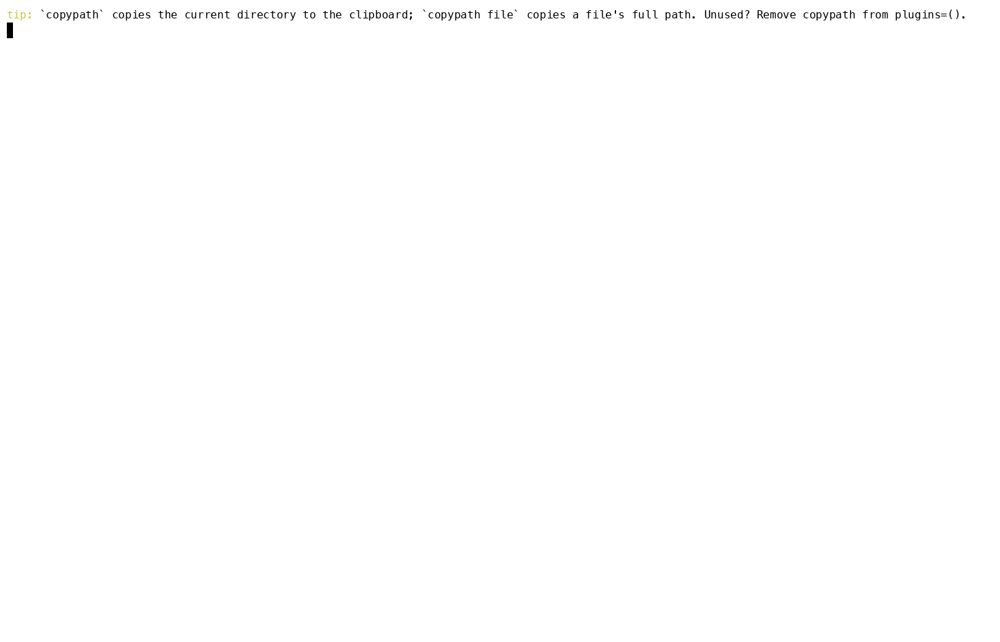

# tuis

Ad-hoc terminal UIs (TUIs) for learning the features of command-line tools.

Each TUI wraps one command and lets you explore its options interactively:
pick flags, see the command line it builds, run it and look at the output.



## Rules

- **TUIs are written in Go.** Use [Bubble Tea](https://github.com/charmbracelet/bubbletea)
  with [Bubbles](https://github.com/charmbracelet/bubbles) and
  [Lip Gloss](https://github.com/charmbracelet/lipgloss). Each TUI is its own
  Go module (its own `go.mod`) with pinned dependency versions.

## Look and feel

Every TUI looks and behaves like [virsh](commands/virsh/) (`commands/virsh/main.go` is the
reference; TUIs share no code, so copy the style names and colours). New TUIs
must follow it, and existing ones are brought in line when touched.

- **Layout**: a top line (bold blue title, then dim context such as version
  and the `★ = popular` / `★ popular only` indicator), the body, and a bottom
  line that shows, in priority order, a confirm prompt, a message, or the dim
  key list for the current screen.
- **Browse**: two bordered panes (rounded, dim border). Left: the list, with
  bold magenta group headings, popular rows in bold orange with a `★`, and the
  selected row in reverse video. Right: the help for the selected item.
- **Options form**: one row per option, `>` marks the cursor, `*` (red) marks
  required options, `★` popular ones; values are yellow, `[x]`/`[ ]` for
  booleans, dim `·` for unset. The selected option's full description is
  shown under the list, and the command line being built (`$ ...`, bold
  green, wrapped) is always at the bottom.
- **Output**: a bold green `$ command` header, the output in a viewport, then
  `[exit N]` in green for 0 and bold red otherwise.
- **Palette** (ANSI): title `12`, group `13`, popular `214`, dim `8`,
  command `10`, warning/error `9`, value/message `11`.
- **Keys**: `↑↓`/`j k` move, `enter` open/set, `esc` (or `q`, `left`) back,
  `p` popular only, `r` run, `t` run in the terminal, `x`/`c` clear, `?` full
  help, `:` execution window, `q` quit from the top screen, `ctrl+c` quits.

## Layout

One directory per command, under `commands/`:

```
commands/<command>/
  README.md    what the TUI covers and how to run it
  go.mod       the TUI's own Go module
  *.go         the TUI itself
```

[master](master/), the menu of the other TUIs, stays at the top level.

## TUIs

- [master](master/): a menu of the other TUIs; pick one to run it.
- [virsh](commands/virsh/): browse every virsh command, build a command line from its
  options, and run it.
- [gh](commands/gh/): browse the GitHub CLI's commands, build a command line from
  their flags, and run it.
- [launchctl](commands/launchctl/): browse launchctl's subcommands (macOS), build a
  command line, and run it.
- [ssh](commands/ssh/): browse ssh tasks (login, tunnels, jump hosts, config), build a
  command line from their options, and run it.
- [openssl](commands/openssl/): browse openssl tasks (certificates, TLS servers, keys, hashes), build a command line from their
  options, and run it.
- [dig](commands/dig/): browse dig tasks (DNS lookups), build a command line from their
  options, and run it.
- [nmap](commands/nmap/): browse nmap tasks (host discovery and port scans), build a command line from their
  options, and run it.
- [nslookup](commands/nslookup/): browse nslookup tasks (simple DNS lookups), build a command line from their
  options, and run it.
- [curl](commands/curl/): browse curl tasks (HTTP requests and downloads), build a command line from their
  options, and run it.
- [wget](commands/wget/): browse wget tasks (downloads and mirroring), build a command line from their
  options, and run it.
- [jq](commands/jq/): browse jq tasks (JSON filtering), build a command line from their
  options, and run it.
- [nc](commands/nc/): browse nc tasks (connections, port checks and listeners), build a command line from their
  options, and run it.
- [lsof](commands/lsof/): browse lsof tasks (open files and who uses a port), build a command line from their
  options, and run it.
- [sudo](commands/sudo/): browse sudo tasks (building and (after confirmation) running elevated commands), build a command line from their
  options, and run it.
- [tree](commands/tree/): browse tree tasks (directory trees), build a command line from their
  options, and run it.
- [pstree](commands/pstree/): browse pstree tasks (the process tree), build a command line from their
  options, and run it.
- [ripgrep](commands/ripgrep/): browse ripgrep tasks (fast recursive search with `rg`), build a command line from their
  options, and run it.
- [fzf](commands/fzf/): browse fzf tasks (the fuzzy finder), build a command line from their
  options, and run it.
- [xargs](commands/xargs/): browse xargs tasks (building and running commands from a list of items), build a command line from their
  options, and run it.
- [awk](commands/awk/): browse awk tasks (fields, patterns and one-line programs), build a command line from their
  options, and run it.
- [sed](commands/sed/): browse sed tasks (substituting, deleting and printing lines), build a command line from their
  options, and run it.
- [pv](commands/pv/): browse pv tasks (progress, rate and ETA of data), build a command line from their
  options, and run it.
- [strace](commands/strace/): browse strace tasks (the system calls a program makes), build a command line from their
  options, and run it.
- [ltrace](commands/ltrace/): browse ltrace tasks (the library calls a program makes), build a command line from their
  options, and run it.
- [systemctl](commands/systemctl/): browse systemctl tasks (inspecting and controlling systemd services), build a command line from their
  options, and run it.
- [journalctl](commands/journalctl/): browse journalctl tasks (reading the systemd journal), build a command line from their
  options, and run it.
- [asciinema](commands/asciinema/): browse asciinema tasks (recording, playing back and sharing terminal sessions), build a command line from their
  options, and run it.

## Building

`make` builds every TUI (binary `commands/<dir>/<dir>-tui`, or `master/master-tui`), `make test` runs all the tests, `make <dir>` / `make test-<dir>` do one TUI, `make clean` removes the binaries. `make install` builds and copies every `<dir>-tui` binary into `~/bin` (`make install-<dir>` for one TUI, `make uninstall` to remove them); set `PREFIX` or `BINDIR` to install elsewhere, e.g.  `make install PREFIX=/usr/local`.
